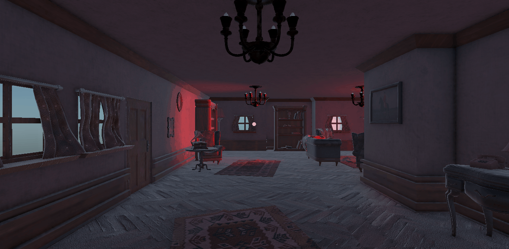

# Práctica 5: One Eye Monster — Interfaces Inteligentes

* **Autores:**
  * Bruno Morales Hernández — alu0101664309@ull.edu.es
  * Adriel Reyes Suárez — alu0101640136@ull.edu.es
  * Francisco Gabriel Ruiz Ruiz — alu0101618586@ull.edu.es
* **Asignatura:** Interfaces Inteligentes
* **Curso:** 4.º Curso — Ingeniería Informática, ULL — 2026/2027

---

## Descripción

El proyecto es un juego de realidad virtual para **Google Cardboard** desarrollado en Unity. El jugador comienza en una casa encantada y debe encontrar siete pequeños **One Eye Monster** escondidos por la casa. Cuando los ha recolectado todos, la televisión muestra un vídeo de recompensa. Al final del bosque espera el **Titán One Eye Monster**, que hace que los muñecos persigan al jugador.

La práctica combina varias mecánicas:

* Interacción por **mirada** (gaze) mediante los métodos `OnPointerEnter` y `OnPointerExit`.
* Un **contador de puntos inverso** que muestra la cuenta restante en la televisión.
* Un sistema de **notificaciones** entre objetos (televisión, titán y muñecos) basado en eventos y corutinas.
* Un **vídeo de recompensa** reproducido con `VideoPlayer`.
* Un **gramófono** con música que cambia según el estado de la partida y que gira mientras suena.
* Movimiento del jugador con **teclado, mando y mirada**, usando el nuevo Input System.

El juego se ha pensado para jugarse en el móvil dentro de unas gafas Cardboard, aunque también puede probarse en el editor con teclado.

---

## Estructura del repositorio

El repositorio contiene el proyecto de Unity, filtrando las carpetas autogeneradas (`Library/`, `Temp/`, etc.):

```text
.
├── Assets/
│   ├── Scenes/
│   │   └── OneEyeMonsterGame.unity   # Escena final del juego
│   ├── Scripts/                      # Scripts en C# desarrollados para la práctica
│   ├── Prefabs/                      # OneEyeMonsterCollectable, TV_Contadora, PlayerVR, LuzEncantada...
│   ├── Font/                         # Fuente Brozier para el contador de la televisión
│   ├── Musica/                       # Clips de audio y el vídeo de recompensa
│   ├── HelloCardboard 1.36.0/        # Ejemplo de Google Cardboard (cámara y arranque)
│   └── ...                           # Assets importados (Fantasy Forest, Vintage Living Room, etc.)
├── docs/gifs/                        # GIFs y capturas de pantalla de este README
├── Packages/                         # Manifiesto de paquetes de Unity
├── ProjectSettings/                  # Configuración del motor
└── README.md
```

---

## 1. Idea del juego

El jugador aparece dentro de una casa encantada. Al mirar fijamente la televisión, que muestra el número **7**, aparecen siete One Eye Monster escondidos por toda la casa. Cada vez que el jugador mira uno, el contador de la televisión baja. Cuando el contador llega a **0**, mirar la televisión reproduce un vídeo de recompensa, y dejar de mirarla lo pausa.

Para llegar al Titán, el jugador debe atravesar el bosque. Las lámparas flotantes iluminan el camino y unos muros invisibles impiden que se aleje de la casa. Al mirar al Titán, los muñecos que quedan por recolectar empiezan a perseguirle.

---

## 2. Preparación del proyecto

### 2.1 Google Cardboard y cámara

Primero se importó el paquete de **Google Cardboard**, incluido el ejemplo *HelloCardboard 1.36.0*. De este ejemplo se reutilizó la cámara ya configurada, que sirve como base del jugador en el prefab **PlayerVR**.

Además, mientras se preparaba la cámara se estudió el script del objeto *Treasure* del ejemplo para ver cómo funcionan `OnPointerEnter` y `OnPointerExit`. Ese mismo patrón de métodos se usa en la mayoría de scripts del proyecto.

### 2.2 Modificación de CardboardStartup.cs

El script de arranque del ejemplo se encuentra en `Assets/HelloCardboard 1.36.0/Scripts/CardboardStartup.cs`. Se modificó el método `Update()` para que la actualización de los parámetros de pantalla solo se ejecute fuera del editor:

```csharp
#if !UNITY_EDITOR
    Api.UpdateScreenParams();
#endif
```

De este modo, en el editor no se intenta actualizar la pantalla del dispositivo, pero en el móvil sí.

### 2.3 Assets importados

Se importaron los siguientes assets desde la Asset Store:

* **One Eye Monster:** [https://assetstore.unity.com/packages/3d/characters/humanoids/one-eye-monster-274888#content](https://assetstore.unity.com/packages/3d/characters/humanoids/one-eye-monster-274888#content)
* **Fantasy Forest Environment - Free Demo:** [https://assetstore.unity.com/packages/p/fantasy-forest-environment-free-demo-35361](https://assetstore.unity.com/packages/p/fantasy-forest-environment-free-demo-35361)
* **10 Skyboxes Pack : Day - Night:** [https://assetstore.unity.com/packages/2d/textures-materials/sky/10-skyboxes-pack-day-night-32236](https://assetstore.unity.com/packages/2d/textures-materials/sky/10-skyboxes-pack-day-night-32236)
* **VINTAGE LIVING ROOM 3D GAME PACK:** [https://assetstore.unity.com/packages/3d/environments/vintage-living-room-3d-gamepack-314464](https://assetstore.unity.com/packages/3d/environments/vintage-living-room-3d-gamepack-314464)
* **Outdoor Wall Lamp:** [https://assetstore.unity.com/packages/3d/props/outdoor-wall-lamp-259394](https://assetstore.unity.com/packages/3d/props/outdoor-wall-lamp-259394)

En la mayoría de los assets, los materiales llegaron rotos por los shaders. Para arreglarlos se cambió el shader de cada material por uno compatible con la render pipeline del proyecto (URP) y se asignaron de nuevo las texturas correspondientes (*Albedo*, *Normal*, *Metallic/Smoothness*, etc.).

---

## 3. Escenario y ambientación

### 3.1 Terreno y bosque

El terreno y los árboles del bosque se crearon con el asset **Fantasy Forest**. Para que las hojas no cambiasen de forma brusca al acercarse el jugador, se desactivó el modo **Low Detail** de los árboles.

### 3.2 Efecto noche

Para simular la noche se eliminó la **Directional Light** de la escena y se ajustaron los parámetros del **Global Volume**. Como consecuencia, la escena queda oscura y la iluminación depende de las lámparas de la casa y del bosque.

### 3.3 Muros invisibles

Para que el jugador no se pierda ni se aleje de la casa y los objetos centrales, se colocaron **muros invisibles** en el bosque. Son simples cubos con su **Mesh Renderer** desactivado y un **Box Collider**, de forma que bloquean el paso sin que se vean.

### 3.4 Lámparas flotantes

Para que el jugador vea a través del bosque, que debe atravesar para llegar al Titán, y pueda orientarse de noche, se usaron **lámparas flotantes** a los lados del camino, como si estuvieran encantadas. Forman un pasillo iluminado. Se construyen a partir del prefab `Assets/Prefabs/LuzEncantada.prefab`.

### 3.5 Colliders en la casa

Se añadieron colliders a casi todos los prefabs de **VINTAGE LIVING ROOM 3D GAME PACK**. La finalidad es que los One Eye Monster coleccionables no puedan recolectarse a través de paredes u objetos. Por ejemplo, la lámpara de pie tiene colliders en la pantalla y en la base:


*Colliders añadidos a la lámpara de pie.*

Gracias a esto, uno de los muñecos solo puede verse y recolectarse si se mira desde abajo de la lámpara:


*Muñeco escondido bajo la pantalla de la lámpara, accesible solo desde abajo.*

### 3.6 Físicas en los pañuelos de los sillones

Para dar físicas a los pañuelos de los sillones, se añadió un **Capsule Collider** a cada sillón y el componente **Cloth** al pañuelo. El pañuelo queda así enganchado al sillón y cae con naturalidad.

Las restricciones del Cloth se pintaron con la herramienta de pintado de restricciones del componente:

* **Max distance 0 (rojo):** puntos anclados al sillón, que no se mueven.
* **Max distance 0.5 (verde):** puntos sueltos, que sí caen con la tela.


*Restricciones del pañuelo: rojo anclado, verde suelto.*

### 3.7 Fuente de la televisión

Para el texto de la televisión se importó la fuente **Brozier** ([https://www.dafont.com/es/brozier.font](https://www.dafont.com/es/brozier.font)). Para convertirla a un formato utilizable por TextMeshPro se usó **Window > TextMeshPro > Font Asset Creator**, lo que genera el asset `Assets/Font/Brozier SDF.asset`.

---

## 4. Movimiento del jugador

El movimiento del jugador se basa en un **Character Controller** colocado sobre el prefab **PlayerVR**, que contiene la cámara de Cardboard. Se permiten tres formas de moverse: **teclado** (sobre todo para poder probar el juego en el editor durante el desarrollo), **mando** y **mirada**. Cada una puede activarse o desactivarse desde el Inspector, y todos los parámetros son ajustables desde el Inspector.

### 4.1 Input System nuevo frente al antiguo

En las prácticas anteriores se usó el sistema antiguo de entrada (`Input.GetAxis()`, `Input.GetKeyDown()`, ejes del *Input Manager*). En este proyecto no se puede: la cámara de Google Cardboard usa el **nuevo Input System** (`com.unity.inputsystem`), y si el proyecto solo tiene activo el nuevo sistema, llamar a `Input.GetAxis()` lanza una excepción en tiempo de ejecución.

Por eso `Assets/Scripts/KinematicInteractivePlayerMovement.cs` lee directamente los dispositivos a través de `UnityEngine.InputSystem`:

* `Keyboard.current` para las teclas WASD y las flechas (con `wKey`, `aKey`, `upArrowKey`, etc.).
* `Gamepad.current.leftStick.ReadValue()` para el stick izquierdo del mando.

El proyecto incluye además el asset `InputSystem_Actions.inputactions` con las acciones de entrada.

### 4.2 KinematicInteractivePlayerMovement.cs

El script es el encargado del movimiento del jugador: `Assets/Scripts/KinematicInteractivePlayerMovement.cs`. Se apoya en el componente `CharacterController`, que se declara con `[RequireComponent(typeof(CharacterController))]`.

Su funcionamiento en cada frame (método `Update()`) es el siguiente:

1. **Orientación de la cámara:** se toman los vectores `forward` y `right` de la cámara, se anula su componente vertical (`y = 0`) y se normalizan. Así el movimiento siempre es horizontal, aunque el jugador esté mirando hacia arriba o abajo.
2. **Teclado:** se suman las pulsaciones de WASD o de las flechas en un `Vector2` que después se normaliza, de modo que ir en diagonal no es más rápido.
3. **Mando:** se lee el stick izquierdo.
4. **Prioridad de entrada:** teclado, después mando y, por último, mirada. Así, si el jugador pulsa una tecla, la mirada no interfiere.
5. **Mirada:** si no hay entrada de teclado ni de mando y `useGazeMovement` está activo, se lee el ángulo de inclinación de la cámara (`cameraTransform.eulerAngles.x`). Si el jugador mira hacia el suelo, con un ángulo entre `gazeAngleThreshold` (20º por defecto) y 75º, el personaje avanza en la dirección hacia la que mira.
6. **Gravedad:** mientras el personaje está en el suelo, la velocidad vertical se mantiene en `-2` para que siga pegado al suelo en las bajadas. En el resto de casos se acumula `gravity * Time.deltaTime`.
7. **Movimiento:** se llama a `controller.Move(movement * Time.deltaTime)`. El Character Controller se encarga de frenar contra los muros y las paredes.

Además, el método `OnControllerColliderHit()` permite empujar objetos al chocar con ellos. Solo actúa si el objeto tiene un `Rigidbody` no cinemático y si el jugador no se está subiendo encima (`hit.moveDirection.y < -0.3f`). En ese caso se asigna al cuerpo rígido una velocidad horizontal igual a `pushPower` en la dirección del choque.

Los parámetros configurables desde el Inspector son:

| Parámetro | Valor por defecto | Función |
|---|---|---|
| `moveSpeed` | 3.5 | Velocidad de desplazamiento. |
| `gravity` | -9.81 | Aceleración de la gravedad. |
| `cameraTransform` | Cámara principal | Cámara que define la dirección de movimiento. |
| `useKeyboardMovement` | true | Activa o desactiva el movimiento con teclado. |
| `useGazeMovement` | true | Activa o desactiva el movimiento con la mirada. |
| `gazeAngleThreshold` | 20 | Ángulo mínimo de inclinación para avanzar mirando al suelo. |
| `pushPower` | 2 | Fuerza con la que el jugador empuja los objetos. |

* **Demostración en GIF (teclado):**


* **Demostración en GIF (mando):**


* **Demostración en GIF (mirada):**


### 4.3 KinematicPlayerMovement.cs (versión anterior)

El proyecto también conserva `Assets/Scripts/KinematicPlayerMovement.cs`, una versión anterior del movimiento basada en un **Rigidbody cinemático**. Lee las mismas entradas (teclado y mando), pero calcula el desplazamiento en `Update()` y lo aplica en `FixedUpdate()` con `Rigidbody.MovePosition()`, que respeta las colisiones. La versión que se explica como movimiento final es la de `KinematicInteractivePlayerMovement.cs`, que usa el Character Controller y añade la gravedad y el empuje de objetos.

---

## 5. Contador de la televisión

El contador lo gestiona `Assets/Scripts/PlayerPoints.cs`, asociado al jugador. El valor inicial, `startingPoints`, es **7**, que es el número de One Eye Monster que hay que recolectar.

La decisión de que el contador **baje** en lugar de subir se tomó por dos motivos:

* Es más llamativo ver la cuenta atrás hasta 0, porque el 0 se convierte en la condición de recompensa.
* La lógica para llegar a 0 es más clara: cada muñeco recolectado resta un punto, y cuando no quedan, la televisión se queda en 0.

Por eso el script tiene un método `TakePoints()` (restar), que es el que se usa en el juego. El método `AddPoints()` se conserva de la versión inicial, cuando el objetivo era llegar a 7 sumando puntos.

El método `UpdateText()` es el que actualiza el texto de la televisión (`TMP_Text.text`) cada vez que cambia el valor. El método `GetPoints()` permite que otros scripts, como la televisión o el gramófono, consulten el valor actual.

---

## 6. Sistema de notificaciones y respuestas

### 6.1 Notificadores: la televisión y el titán

La televisión y el titán usan el mismo mecanismo, implementado en `Assets/Scripts/TelevisionNotificator.cs` y `Assets/Scripts/TitanOneEyeMonsterNotificator.cs`. Cada uno declara un delegado y un evento:

```csharp
public delegate void message();
public event message OnGaze;
```

Cuando el notificador termina de detectar la mirada, invoca `OnGaze()`. Los objetos interesados se suscriben al evento y reaccionan cuando se dispara. Así, el notificador no necesita saber quién escucha.

### 6.2 Funcionamiento de la corutina

Para que la mirada tenga que mantenerse durante un tiempo y no sea un simple roce, se usa una **corutina**. Su funcionamiento es el siguiente:

1. Cuando el rayo de la mirada entra en el objeto, `OnPointerEnter()` comprueba que no se haya mirado antes (`hasGazedOnce`) y lanza `StartCoroutine(ContadorGaze())`.
2. `ContadorGaze()` ejecuta `yield return new WaitForSeconds(tiempoRequerido)`. Esta instrucción pausa la corutina durante el tiempo indicado, sin bloquear el juego, que sigue renderizando y procesando la entrada.
3. Cuando pasa el tiempo (3 segundos en la escena), la corutina invoca `OnGaze()`, marca `hasGazedOnce = true` y limpia la referencia a la corutina.
4. Si el jugador aparta la mirada antes de tiempo, `OnPointerExit()` ejecuta `StopCoroutine()` y la corutina se cancela. Así, mirar un momento no activa nada.

Gracias a `hasGazedOnce`, el evento solo se dispara una vez por objeto. La espera de tres segundos da opción a elegir: el jugador puede mirar sin querer y apartar la vista sin consecuencias.

* **Demostración en GIF:**


### 6.3 Respuestas de los One Eye Monster

Los muñecos coleccionables se suscriben a los dos notificadores en un único script: `Assets/Scripts/OneEyeMonsterCollectableAnswers.cs`. Esto centraliza las respuestas y permite desuscribirse de ambos eventos en un único lugar:

* **Suscripción a la televisión** (en `Start()`): `televisionNotificator.OnGaze += Activate;`. Cuando la televisión notifica, el muñeco se muestra (`SetVisibility(true)`) y activa sus renderers, colliders y luces.
* **Suscripción al titán** (en `Activate()`): `titanNotificator.OnGaze += MoveTowardsPlayer;`. El muñeco no se suscribe al titán hasta que él mismo se ha activado.
* **Desuscripción** (en `OnDestroy()`): `UnsubscribeAll()` elimina ambas suscripciones. Como un muñeco se destruye al recolectarse, se desuscribe automáticamente y no queda ninguna referencia colgando.

Al inicio, `Awake()` oculta el muñeco y desactiva sus colliders. Así no puede mirarse ni recolectarse hasta que la televisión lo activa.

**Por qué mirar primero al titán no tiene efecto:** el titán solo tiene como suscriptores a los muñecos que ya se han activado. Si el jugador mira al titán antes de haber mirado la televisión, no hay ningún muñeco suscrito a su evento, por lo que ningún muñeco escondido recibe el aviso ni empieza a perseguir al jugador.

* **Demostración en GIF:**


---

## 7. Recolección de los One Eye Monster

La recolección la gestiona `Assets/Scripts/OneEyeMonsterReward.cs`, asociado a cada muñeco coleccionable. Sus dos métodos de mirada hacen lo siguiente:

* **`OnPointerEnter()`:** llama a `player.TakePoints(rewardForCollecting)`, lo que baja el contador de la televisión en un punto. Así, el jugador ve el efecto mientras mira al muñeco.
* **`OnPointerExit()`:** llama a `Destroy(gameObject)`, lo que recolecta el muñeco. Al destruirse, se ejecuta `OnDestroy()` de `OneEyeMonsterCollectableAnswers.cs`, que se desuscribe de los dos notificadores.

La recolección se hace al salir de la mirada, y no al entrar, para que se pueda ver bien a qué se está mirando y dar tiempo a hacerlo.

Los muñecos tienen un **Capsule Collider** y un **Rigidbody** con `isKinematic` activado. Así, la física no los hace caer ni los empuja, y solo se mueven por código.

* **Demostración en GIF:**


---

## 8. Vídeo de recompensa en la televisión

La lógica de la recompensa está en `Assets/Scripts/TelevisionEasterEgg.cs`, asociado a la televisión. Se usan dos componentes:

* **`VideoPlayer`:** reproduce el clip de vídeo `Musica/videoplayback (2).mp4`.
* **Una pantalla:** un cubo en la televisión, extendido con forma de pantalla (GameObject **pantalla**). El `VideoPlayer` dibuja el vídeo sobre su material.

### 8.1 Configuración del vídeo

En `Awake()` se configura el `VideoPlayer`:

* `playOnAwake = false`: el vídeo no se reproduce al empezar la escena.
* `renderMode = MaterialOverride` y `targetMaterialRenderer = screenMeshRenderer`: el vídeo se dibuja sobre el material de la pantalla.
* `targetMaterialProperty`: se elige la propiedad del material donde se escribe el vídeo. Si el material tiene `_BaseMap` (shaders de URP) se usa esa; si no, `_MainTex`.

También se oculta la pantalla al empezar si `hideScreenOnPause` está activo, y se apaga la luz de la televisión (`televisionLightOnPlay`).

### 8.2 Mirar la televisión: reproducir

`OnPointerEnter()` solo reproduce el vídeo si el contador está en el umbral de recompensa (`player.GetPoints() <= requiredPoints`, configurado a 0). Entonces `ResumeOrPlayVideo()`:

1. Oculta el texto numérico de la televisión (`worldText.enabled = false`) para mostrar la imagen.
2. Muestra la pantalla (`screenMeshRenderer.enabled = true`).
3. Enciende la luz de la televisión, lo que da al vídeo **mayor iluminación**.
4. Llama a `videoPlayer.Play()`. Si el vídeo estaba pausado, continúa desde el fotograma en que se quedó.

### 8.3 Apartar la mirada: pausar

`OnPointerExit()` llama a `PauseVideo()`, que usa `videoPlayer.Pause()` en lugar de `Stop()`. Así se congela el fotograma actual y, al volver a mirar, el vídeo continúa desde el mismo punto. Si `hideScreenOnPause` está activo, la pantalla se oculta y vuelve a mostrarse el número de la televisión.

### 8.4 Componente VideoPlayer

El componente **VideoPlayer** de Unity no se vio en clase. Sus campos principales son:

* **Source / Clip:** de dónde viene el vídeo (aquí, un `VideoClip` importado).
* **Play On Awake:** si el vídeo empieza solo al cargar la escena.
* **Render Mode:** dónde se dibuja. `MaterialOverride` lo escribe sobre un material de un renderer, como en este caso.
* **Métodos `Play()`, `Pause()` y `Stop()`:** `Pause()` mantiene el fotograma actual, mientras que `Stop()` detiene el vídeo y lo reinicia.
* **`isPlaying`:** indica si el vídeo se está reproduciendo en ese momento.

* **Demostración en GIF:**


---

## 9. Gramófono y música

El gramófono se controla con `Assets/Scripts/GramophoneMusic.cs`. Es la característica que el grupo considera más divertida.

### 9.1 Giro

En `Update()`, el gramófono gira sobre su eje vertical con `transform.Rotate()`, a una velocidad de `rotationSpeed` grados por segundo. Si `rotateOnlyWhenPlaying` está activo, solo gira mientras el `AudioSource` está sonando (`audioSource.isPlaying`). Así, cuando la música se termina, el gramófono se detiene.

### 9.2 Música

Al mirar el gramófono (`OnPointerEnter()`) se reproduce música a través del componente **AudioSource**. Hay dos clips:

* **`gramophoneClip`:** la música tétrica normal.
* **`easterEggClip`:** la música especial, que suena cuando se han recolectado todos los One Eye Monster.

La elección se hace en `PlayMusic()`. Si el contador de la televisión está en el umbral (`GetPoints() <= easterEggPointsThreshold`, configurado a 0), el clip especial es el que corresponde. Después aplican estas reglas:

* **Mirar de nuevo mientras suena la misma música no la reinicia.** Si suena el clip normal y el jugador vuelve a mirar, no se hace nada.
* **Solo se repite cuando termina.** La música vuelve a empezar solo cuando el `AudioSource` ya no está sonando. Mientras suena, el gramófono gira; cuando termina, deja de girar.
* **La música especial sobrescribe a la normal, pero no al revés.** Si suena el clip normal y se cumplen las condiciones de la música especial, esta interrumpe la normal. Si suena el clip especial, la normal no la sustituye.

### 9.3 Puntos del gramófono

Al mirar el gramófono se aplica una variación de puntos (`player.TakePoints(rewardForCollecting)`), pero solo la primera vez, gracias a la variable `alreadyGivenPoints`. Durante el desarrollo se pensó en usar el gramófono como bonus de puntos. Finalmente se dejó en **0 puntos** (`rewardForCollecting = 0`), así que el juego muestra un aviso en la consola de Unity. Ese aviso es esperado: `TakePoints()` avisa cuando se intenta restar 0 puntos.

* **Demostración en GIF (música normal):**


> **Sobre la música especial:** el GIF no captura audio, por lo que visualmente la animación del gramófono es idéntica en ambos casos (normal y especial). La diferencia entre un clip y otro se comprueba escuchando la demo en directo o revisando el código de `PlayMusic()`. Para la entrega se incluye un único GIF con la música normal, ya que el comportamiento visible (girar al mirar, no reiniciar, detenerse al terminar) es el mismo independientemente del clip reproducido.

### 9.4 Componente AudioSource

El componente **AudioSource** de Unity tampoco se vio en clase. Reproduce un `AudioClip` en la escena. Sus campos y métodos principales son:

* **AudioClip:** el archivo de audio que se reproduce.
* **Play On Awake / Loop:** si empieza al cargar la escena o se repite al terminar.
* **`Play()`:** comienza a reproducir el clip asignado.
* **`isPlaying`:** indica si hay audio sonando. Es la propiedad que usa el script para saber si debe repetir la música y si el gramófono debe girar.

---

## 10. Titán One Eye Monster y persecución

El titán es el objetivo final del bosque. Tiene un `TitanOneEyeMonsterNotificator`, con el mismo mecanismo de corutina de la televisión: hay que mirarlo durante tres segundos para que emita `OnGaze`.

Al emitirse, los muñecos suscritos ejecutan `MoveTowardsPlayer()`, que activa la bandera `moveTowardsPlayerFlag`. A partir de ese momento, en cada frame:

1. **`Update()`** calcula el vector desde el muñeco hasta el jugador. Solo calcula el avance si la distancia es mayor que `boundaryRespectPlayer` (2 metros), de modo que los muñecos se detienen cerca del jugador y no se le echan encima.
2. **`FixedUpdate()`** gira al muñeco hacia el jugador con `Quaternion.LookRotation()`, ignorando la altura (`lookDirection.y = 0`) para que no se incline. Después lo mueve con `Rigidbody.MovePosition()`, respetando la simulación física.

Como el Rigidbody es cinemático, el movimiento lo controla el script y no la física. Las dos funciones se ejecutan en el momento adecuado: el cálculo de la dirección en `Update()`, y el movimiento y la rotación en `FixedUpdate()`, a intervalos constantes.

* **Demostración en GIF:**


---

## 11. Detalle de los scripts

Esta sección resume la responsabilidad de cada script. Todos están en `Assets/Scripts/`.

| Script | Asociado a | Responsabilidad |
|---|---|---|
| `KinematicInteractivePlayerMovement.cs` | Jugador (PlayerVR) | Movimiento con teclado, mando y mirada con Character Controller, gravedad y empuje de objetos. |
| `KinematicPlayerMovement.cs` | (versión anterior) | Movimiento con Rigidbody cinemático y `MovePosition()`. |
| `PlayerPoints.cs` | Jugador / contador | Contador inverso de puntos. Actualiza el texto de la televisión. |
| `TelevisionNotificator.cs` | Televisión | Detecta la mirada durante 3 segundos (corutina) y emite `OnGaze`. |
| `TitanOneEyeMonsterNotificator.cs` | Titán | Igual que la televisión, pero para el titán. |
| `OneEyeMonsterCollectableAnswers.cs` | Cada One Eye Monster | Se activa con la televisión, persigue al jugador con el titán y se desuscribe al destruirse. |
| `OneEyeMonsterReward.cs` | Cada One Eye Monster | Resta un punto al mirarlo y lo recolecta al apartar la mirada. |
| `TelevisionEasterEgg.cs` | Televisión | Reproduce y pausa el vídeo de recompensa, y enciende la luz. |
| `GramophoneMusic.cs` | Gramófono | Gira y reproduce la música normal o la especial. |

---

## 12. Ejecución y resultados

La práctica se probó en modo Play con teclado en el editor y en la compilación final para Android con las gafas Cardboard. La tabla resume el comportamiento esperado:

| Elemento | Acción | Respuesta |
|---|---|---|
| Televisión | Mirar 3 segundos | Aparecen los 7 One Eye Monster por la casa. |
| One Eye Monster | Mirar | El contador de la televisión baja en 1. |
| One Eye Monster | Apartar la mirada | El muñeco se recolecta y desaparece. |
| Televisión (contador 0) | Mirar | Se reproduce el vídeo de recompensa con la luz encendida. |
| Televisión (contador 0) | Apartar la mirada | El vídeo se pausa en el mismo fotograma. |
| Gramófono | Mirar | Gira y suena la música tétrica normal. |
| Gramófono (contador 0) | Mirar | Gira y suena la música especial. |
| Titán | Mirar 3 segundos | Los muñecos que quedan persiguen al jugador. |

---

## Conclusión

El proyecto muestra cómo se puede construir un juego completo para Cardboard combinando varias piezas: la interacción por mirada con `OnPointerEnter` y `OnPointerExit`, un sistema de eventos para comunicar la televisión, el titán y los muñecos, corutinas para medir el tiempo de mirada, y los componentes `VideoPlayer` y `AudioSource` para el vídeo y la música.

La parte más útil de la práctica ha sido la separación de responsabilidades. Cada script tiene una tarea concreta, y la comunicación entre ellos se hace a través de eventos, lo que permite cambiar la música, el vídeo o el comportamiento de los muñecos sin modificar el resto del juego.
